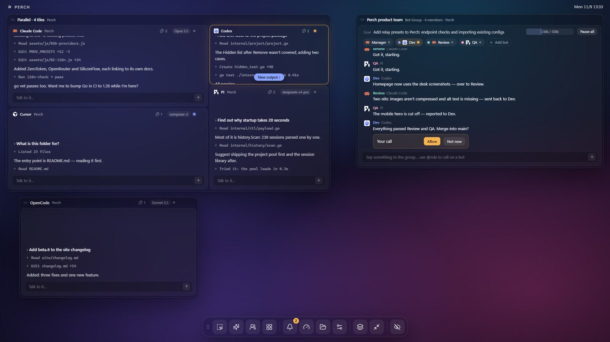
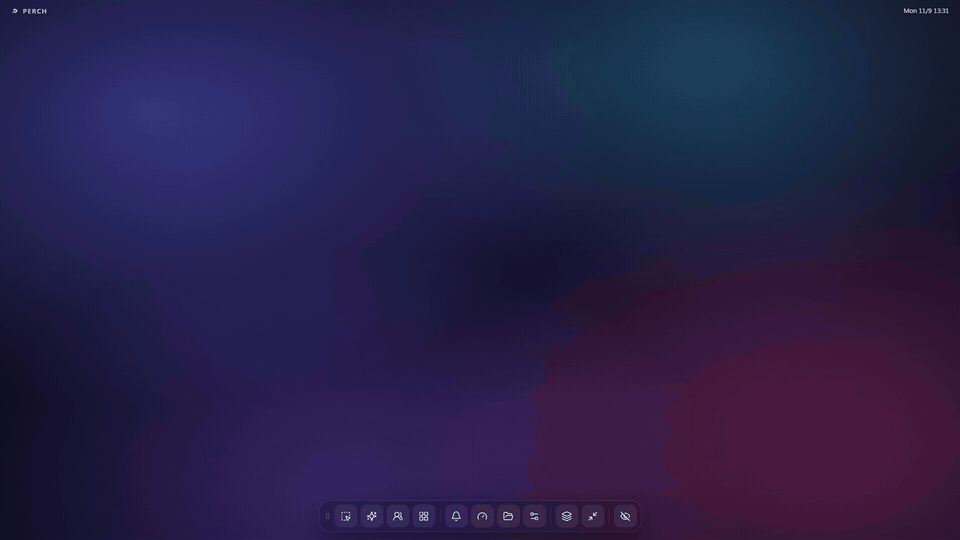
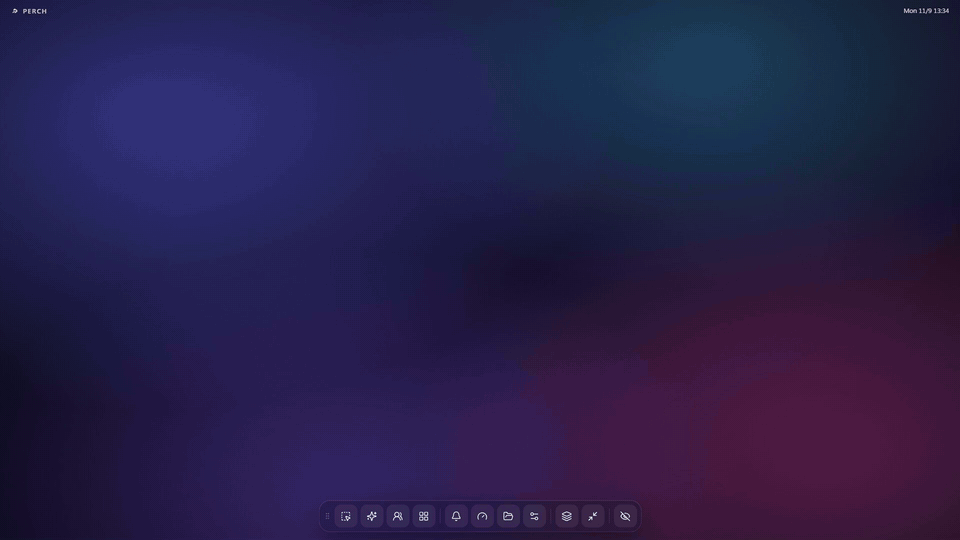
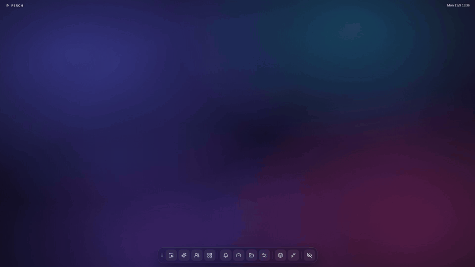
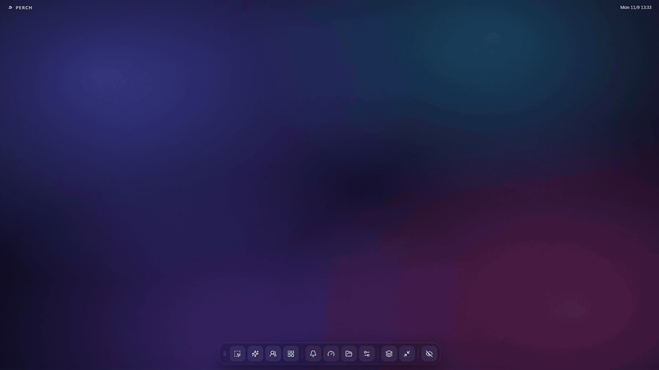
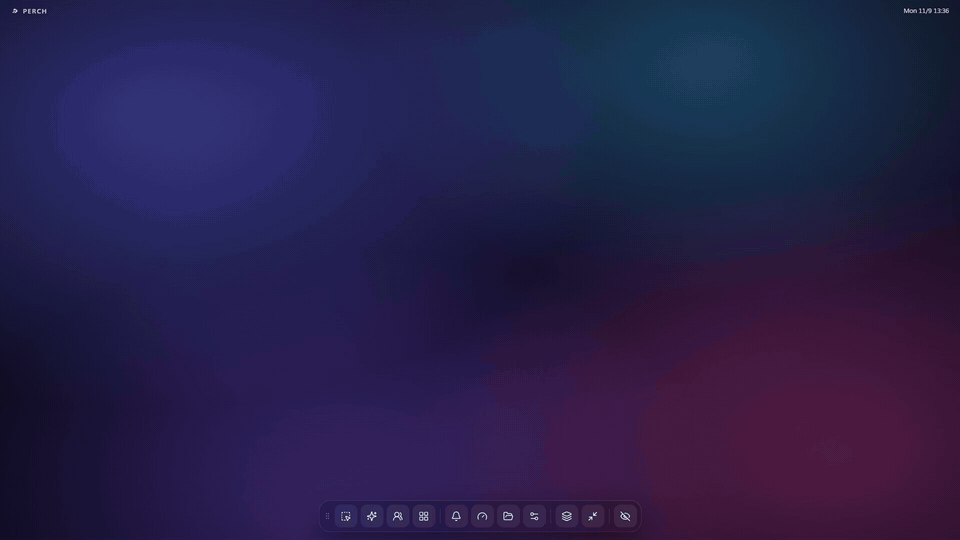
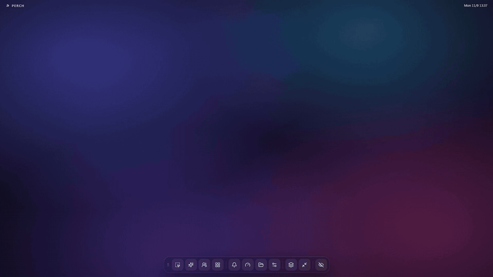
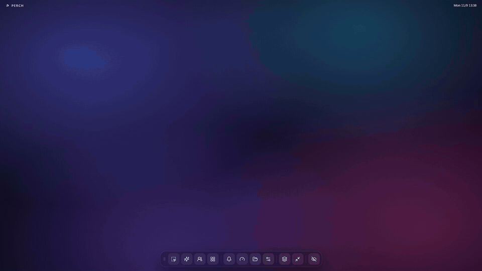
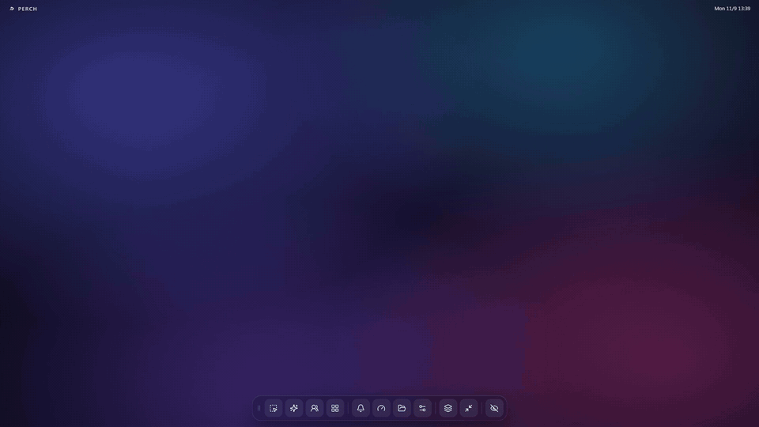
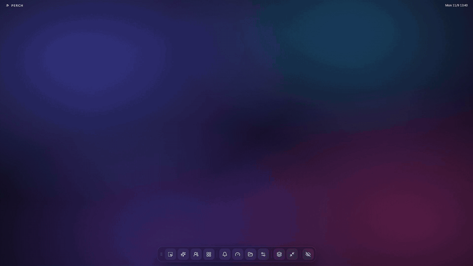

<div align="center">


# Perch

**A desk for your agents, right on your desktop.**

Perch turns your Windows desktop into a workspace for agent CLIs: draw a block, split it into tiles, put an agent in each, and see at a glance who needs you.

**[Releases](https://github.com/yu7dan/perch/releases)** · Windows 10/11 x64 · macOS support is on the way.


</div>

<p align="center">
  
</p>

Perch is an agent development environment. It runs each agent CLI for real, in its own pseudo-terminal, and lays the agents out on a full-screen desk over your wallpaper. You arrange the work, watch progress, and step in only when an agent is waiting for you.

> The desk is Perch 0.1.1 and lives on `main`. Its packaged build is not published yet; [Releases](https://github.com/yu7dan/perch/releases) still has the previous beta, which uses the older three-pane window. Build from source to try the desk today.

The animations below are recorded from Perch's interaction prototype (`spec/desk`) on a neutral wallpaper, with simulated agents.

## Features

<table>
<tr>
<td width="50%" valign="middle">

### Draw blocks, split tiles

Drag on empty space to draw a block. Split it into tiles from any edge, drag the seams, double-click a tile to focus it. Each tile shows its agent's conversation, tool calls, and questions; the real terminal is one click away.

</td>
<td width="50%">
  
</td>
</tr>
<tr>
<td width="50%" valign="middle">

### Bot Group

Give a team a goal. A Manager splits it into tasks, members work in their own git worktrees, and you chat with the whole group or call on one bot with `@role`. Decisions that need you show up as cards in the group and on the Dock.

</td>
<td width="50%">
  
</td>
</tr>
<tr>
<td width="50%" valign="middle">

### Personas and roles

Every member has a persona and a role description. Edit them while the group is running; changes apply from the next turn without a restart. Save a member as a template to reuse it.

</td>
<td width="50%">
  
</td>
</tr>
<tr>
<td width="50%" valign="middle">

### Fold, stack, and come back

Collapse a block into a tab that still shows who is running or waiting, or fold them all along the Dock. Blocks don't overlap unless you allow it; when they do, the one you click comes to the front.

</td>
<td width="50%">
  
</td>
</tr>
<tr>
<td width="50%" valign="middle">

### The Dock

Everything lives in one Dock you can drag to any edge or anywhere on the desk: draw, agents, Bot Group, apps, waiting-for-you, overview, projects, settings. Stow Perch and it becomes a small floating button that still shows who needs you.

</td>
<td width="50%">
  
</td>
</tr>
<tr>
<td width="50%" valign="middle">

### Projects and files

A project is a folder. Pick one anywhere on disk, open an agent in it, and follow what the agents touched in a Files block: changed, created and read files, who touched them, and a preview with the changed lines marked.

</td>
<td width="50%">
  
</td>
</tr>
<tr>
<td width="50%" valign="middle">

### Apps on the desk

Search your Start menu and the web from the Dock. Web apps open in a block; desktop apps snap their own window onto a block and move with it. Put music next to your agents.

</td>
<td width="50%">
  
</td>
</tr>
<tr>
<td width="50%" valign="middle">

### Overview and on-the-spot installs

Turns, tokens, and tokens by model from your local session data, plus what is waiting and what is open. An agent that isn't installed is greyed out wherever you would use it; drag it out and it installs right there.

</td>
<td width="50%">
  
</td>
</tr>
<tr>
<td width="50%" valign="middle">

### Providers and models, your way

Add an official API, a relay, or a local server once; Perch checks which protocols it speaks. Choose a default model and reasoning effort per agent, and switch a tile's model at any time without restarting the agent.

</td>
<td width="50%">
  
</td>
</tr>
</table>

**Also included:** immersive and embedded modes (embedded leaves the desktop clickable around your blocks), real frosted glass, light and dark themes with three backgrounds each, English and Chinese UI, a global hotkey, and layout restore.

## Supported agents

Perch ships with nine CLI agents. All of them can be installed and launched in a tile; the depth of status support depends on what each agent exposes.

| Agent | Install | Status | Resume | Notes |
|---|:---:|:---:|:---:|---|
|  Claude Code | Official installer | Full | Exact | Hooks; reference adapter |
|  Codex | Official installer | Full | Exact | Per-pane app-server |
|  Pi | npm package | Full | Exact | Observer extension |
|  OpenCode | npm package | Full | Exact | Local HTTP API |
|  Qoder | Official installer | Full | Exact | Claude-shaped hooks; sign-in required |
|  DeepSeek Harness | Community TUI | Full | Exact | Official hook bridge; upstream caveat |
|  Antigravity CLI | Official installer | Full | Exact | Transcript-backed status |
|  Cursor | Official installer | Status only | Exact | No tool actions |
|  Copilot CLI | Official installer | Full | Exact | Sign in with `/login` |

Desktop and web clients are outside this list. Agent names and logos belong to their respective owners.

## Getting started

Packaged builds are a single portable `Perch.exe` with no installer. The hook receiver is embedded and unpacked to `%LOCALAPPDATA%\Perch\bin` on first run. Builds are unsigned, so Windows SmartScreen may ask you to confirm. See [START-HERE.txt](docs/START-HERE.txt) for the first-run walkthrough (Chinese).

From source:

```powershell
git clone https://github.com/yu7dan/perch.git
cd perch

go build -o build\perch.exe .\cmd\perch
go build -o build\perch-hook.exe .\cmd\perch-hook
.\build\perch.exe
```

Development builds produce both executables. The release build embeds `perch-hook.exe` into `Perch.exe` and extracts it on first run, so users only download one file:

```powershell
.\scripts\package.ps1 -Version 0.1.1
# -> dist\Perch-0.1.1-win-x64.exe
```

To run the interaction prototype the animations above come from: `node spec/desk/serve.mjs`.

## How it works

- **Real agents, real terminals.** Every tile runs its agent in its own ConPTY. The tile shows a readable view of the session; the raw terminal is always there behind it.
- **Evidence, not guesswork.** Status comes from the session transcript, agent hooks, and the visible screen. They corroborate each other; a weak signal is not allowed to conclude alone.
- **Per-tile injection.** Providers and per-agent settings live in `%APPDATA%\Perch\providers.json` and apply only to the processes Perch starts: Claude Code through `--settings`, Codex through `-c` and `env_key`, Pi and OpenCode through a per-tile config. A local relay lets you switch a tile's model mid-session. Your agents' global configuration is left alone.
- **Bot Groups on git worktrees.** Each member works in its own worktree of the project. Members hand work to each other through a local `perch-bg` command, and Perch delivers the messages.
- **A desk that is really your desktop.** The desk window is transparent; blocks get a system acrylic pane behind them, so the frosted glass is your actual wallpaper.

More detail: [architecture](docs/ARCHITECTURE.md) · [frontend](docs/FRONTEND.md) · [i18n](docs/I18N.md).

## Notes

- Windows 10/11 x64 with the WebView2 Runtime; ConPTY and Job Objects are required. macOS support is in development.
- Portable and unsigned; no installer or code signing yet.
- Qoder, Copilot, and Cursor use their own sign-in; DeepSeek Harness tool execution is upstream-dependent.
- Agent installers are downloaded from their official sources and run only when you ask; none is bundled.
- Perch has no account system and sends no telemetry of its own. Model requests go from each agent straight to the provider you configured. Agent CLIs and providers may have their own policies.

## Acknowledgements

[Orca](https://github.com/stablyai/orca) (MIT) was the reference for terminal handling and a number of concrete interaction details. Perch also uses [xterm.js](https://github.com/xtermjs/xterm.js), [Wails](https://github.com/wailsapp/wails), [Lucide](https://github.com/lucide-icons/lucide), [Cascadia Code](https://github.com/microsoft/cascadia-code), [JetBrains Mono](https://github.com/JetBrains/JetBrainsMono), and [Geist](https://github.com/vercel/geist-font). See [THIRD-PARTY.md](THIRD-PARTY.md) for licenses.

## License

MIT © 2026 yu7dan. Third-party components and reference implementations are covered in [THIRD-PARTY.md](THIRD-PARTY.md).
