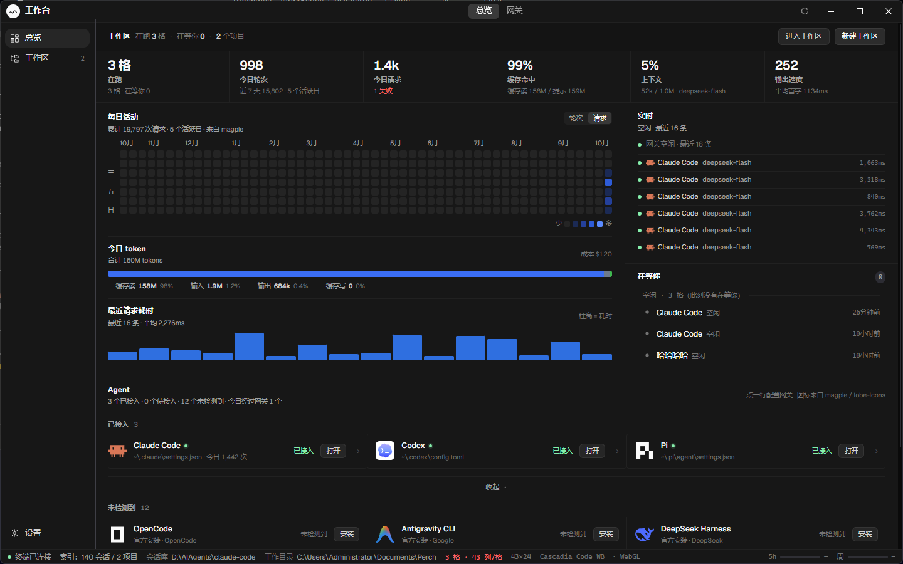
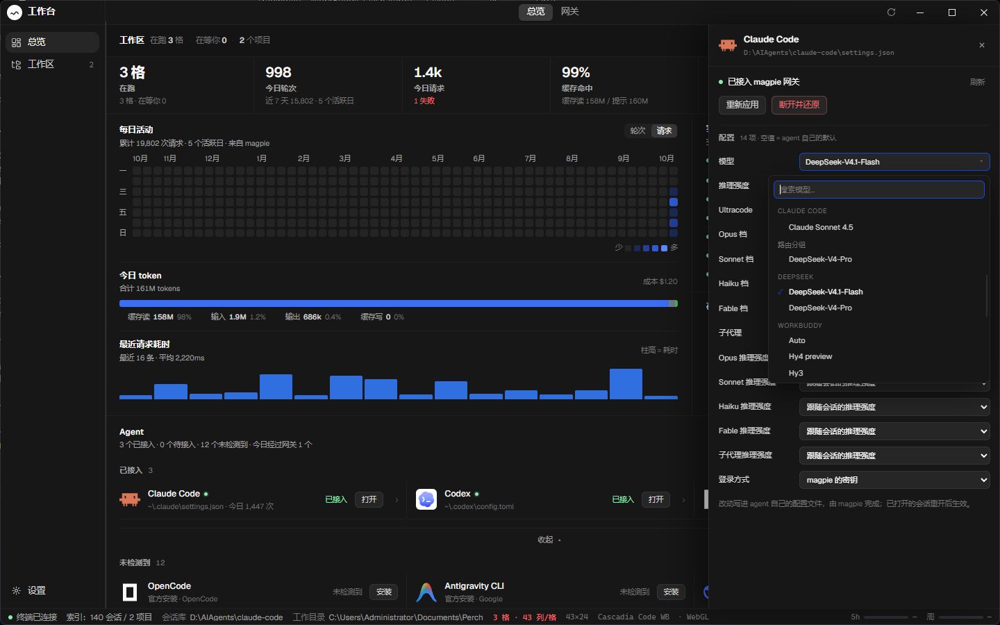
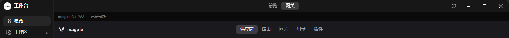

<div align="center">

# Perch <sub>栖枝</sub>

**把 agent 终端装进桌面的工作环境。**<br>
一个窗口里并排跑多个 agent，一格一个真终端；收起终端，它就是一块"谁在等你"的工作看板。


</div>

<p align="center">
  
</p>

Perch 是面向"agent 终端"的 Windows 桌面网关，与 Orca 同属 **agent 开发环境**这一类。
终端本身就是主界面 —— 你看到的每个格子都是一个活着的 ConPTY，agent 在里面正常跑；
外层做的事是**让 N 个这样的格子同时可看、可管，并且在它停下来等你的时候叫得够清楚**。
它不是"并排跑 N 个某一个 agent"：agent 是哪一家由你决定，这一层只做终端与工作环境。

## 它解决什么

每个 agent 都有自己的会话、自己的状态、自己的"正在等你"。开三个终端，你就得在三个窗口之间来回看。
Perch 把这些收进一个窗口：

- **一格一个真终端**：并行网格、独立页、标签与状态点；滚动缓冲留在本地，切回来还在。
- **attention-first**：谁停下来等你，谁排在前面；「需要你」里直接给选项，点一下答掉那一问。
- **收起终端就是工作看板**：一行一个 agent，固定行高，不呈现正文；点行 = 进那一格。
- **网关不另做一套**：供应商、路由、用量、插件用 magpie 的原生界面，Perch 只负责把它嵌进来、把 Agent 接进去。

## 界面

<table>
<tr>
<td width="50%" valign="middle">

### Agent 接线与模型选择

接入 / 断开 / 重新应用 / 保留现状；长模型列表变成可搜索的弹层，当前值自动带进视野。
配置来自 magpie 的 `/api/state`，写操作也走同一组 API —— Perch 不另存一份。

</td>
<td width="50%">
  
</td>
</tr>
<tr>
<td width="50%" valign="middle">

### 内嵌 magpie 网关

供应商、路由、用量、插件用 magpie 自己的页面；版本与更新条由 Perch 接住。
更新是 magpie 自己的 `check → install`，re-exec 之后 Perch 按端口认领新进程。

</td>
<td width="50%">
  
</td>
</tr>
</table>

<p align="center">
  <sub>总览、Agent 抽屉与网关页都来自真实运行中的 Perch；界面会继续变。</sub>
</p>

## 支持的 agent

<table align="center">
<tr>
<td align="center" width="20%"><br><sub>Claude Code</sub></td>
<td align="center" width="20%"><br><sub>Codex</sub></td>
<td align="center" width="20%"><br><sub>Pi</sub></td>
<td align="center" width="20%"><br><sub>OpenCode</sub></td>
<td align="center" width="20%"><br><sub>WorkBuddy</sub></td>
</tr>
</table>

总览里内置了这些 agent 的图标、安装与接线入口；未安装的会在「未检测到」里列出，
能自动安装的直接给「安装」，桌面应用则提示去官网。目录里还有更多 agent ——
任何能设置 base URL 的客户端，也可以接到 Perch 的网关。

> 状态解析目前以 Claude Code 的终端输出为样本；换别的 agent 需要补规则（见「现状」）。

## 数据从哪来

三条腿，优先级从硬到软（一条比一条虚，所以排序不能反）：

1. **转录** —— 磁盘上的会话 JSONL。说了什么、还在不在等某个工具，都是结构化事实；
2. **hook** —— agent 自己的 hook 事件，状态变化来得最快；
3. **屏幕** —— 读终端缓冲。兜底，而且有些东西**只有屏上有**（比如一张提问"现在问到第几问"）——
   转录要等整张提问收尾才落结果。

三条腿互相印证，不信的那一条不许单独下结论（"答了 No"不算完成、"还在转圈"有一道
合成兜底并**标明**它是合成的）。

## 构建

需要 Windows 11（ConPTY）、Go 1.27+。前端没有打包器：一个 `index.html` 加资产，
`go:embed` 直接进二进制。

```powershell
go build -o perch.exe .
go build -o perch-hook.exe ./hookrecv   # ⚠️ hook 接收器：代码里按这个名字找它
.\perch.exe
```

需要两个产物：主程序，和一个几 KB 的 **hook 接收器**（agent 的 hook 事件由它落盘，
主程序再去读）。⚠️ 接收器的文件名**写死在代码里**（`hooks.go` 的 `hookExeName`），
两个 exe 必须并排放在同一目录 —— 少一个的症状是"功能静默消失"。

## 现状

- **实验性**，接口会变；
- 只在 Windows 上（依赖 ConPTY 与 Job Object）；
- 状态解析目前以 Claude Code 的终端输出为样本；规则表可扩展，别的 agent 需要补规则；
- 进程名、状态目录、hook 接收器统一叫 `perch` / `Perch`；不依赖本机绝对路径，
  换一台机器会用那个人自己的 Claude 状态根（`CLAUDE_CONFIG_DIR`，没设则 `~/.claude`）。

## 给贡献者

前端为什么是 classic script + defer、某个文件该放什么、图标规则、改完为什么必须重建 ——
都在 [docs/STRUCTURE.md](docs/STRUCTURE.md)。

## 致谢

这个项目参考过两个开源实现，学的是**具体工序**（终端面板的排版、状态点的字形、
活动流"一个 agent 一行"的降噪合同、自动滚动状态机……），架构与数据面是我们自己定的。
逐项列在 [THIRD-PARTY.md](THIRD-PARTY.md) 里，包括它们的许可。

- [Orca](https://github.com/stablyai/orca)（MIT）—— 界面样式与一批实现细节
- [Magpie](https://github.com/yetone/magpie)（MIT）—— 桌面质感与用量面板的信息组织

以及 [xterm.js](https://github.com/xtermjs/xterm.js)、[Wails](https://github.com/wailsapp/wails)、
[Cascadia](https://github.com/microsoft/cascadia-code)、[JetBrains Mono](https://github.com/JetBrains/JetBrainsMono)、
[Geist](https://github.com/vercel/geist-font)。

## 许可

MIT © 2026 yu7dan。第三方组件与参考实现的许可见 [THIRD-PARTY.md](THIRD-PARTY.md)。
