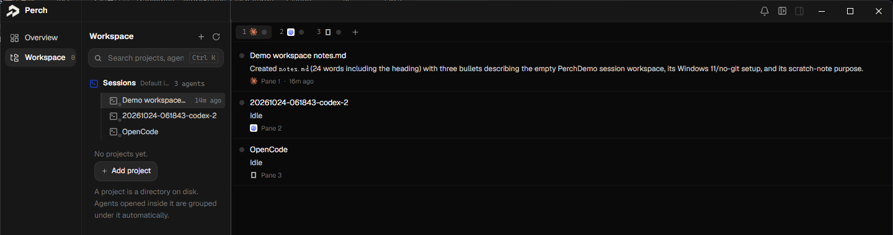
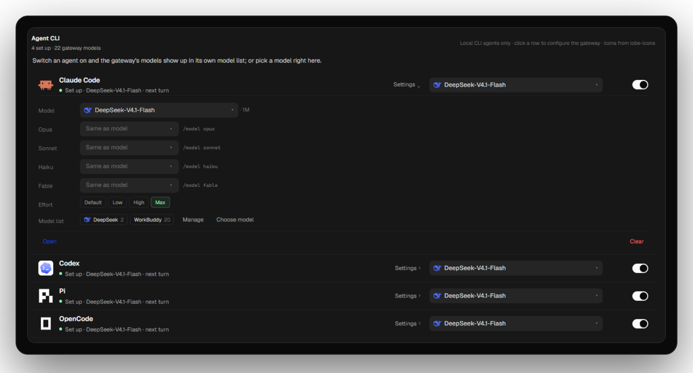

<div align="center">


# Perch

**Run your agents side by side. See who needs you.**

Perch is a Windows desktop workspace for agent CLIs: one real terminal per pane, one place to see status, and model providers you choose per agent.

**[Download the beta](https://github.com/yu7dan/perch/releases)** · Windows 10/11 x64 · macOS support is on the way.


</div>

<p align="center">
  <a href="docs/images/overview.png"></a>
</p>

Perch is an agent development environment, not a chat client. It owns the terminals and the workspace; each agent runs normally inside its own pane, and the provider you pick is injected into that pane without taking over the agent.

## Why Perch

- **One real terminal per pane.** Every pane is a live ConPTY with its own scrollback and status dot. Switching does not lose output.
- **Attention first.** Whoever is waiting for you is visible at a glance, in the grid or on the work board.
- **Providers with a boundary.** Add a provider once and pick it per agent. Keys are encrypted on this machine, settings are applied per pane, and Perch never rewrites your global agent configuration.

## A work board, not a tab graveyard

Collapse the terminal grid and each agent becomes one fixed-height row: what it last said, whether it is idle or waiting, and one click back into its pane. The row is a summary, not a second transcript.

<p align="center">
  <a href="docs/images/work-board.png"></a>
</p>

## Agent setup in one place

Install, configure, and open an agent from the same list. Perch detects what is installed, runs the official installer or npm package when you ask, and applies each agent's provider, model, effort, and environment variables per pane, where the agent exposes them. Model lists come from a live connection test, not a second hand-kept copy.

<p align="center">
  <a href="docs/images/agent-setup.png"></a>
</p>

## Model providers, your way

Add an official API, a relay, or a local server once in Settings: an Anthropic and/or OpenAI-compatible endpoint plus a key. The key is encrypted with Windows DPAPI and never shown again. Then choose per agent: Claude Code takes Anthropic endpoints, Codex takes OpenAI-compatible ones, Pi and OpenCode take either. Leave it unset and the agent keeps its own sign-in. Raw environment variables cover everything else.

**Also included:** a local-data overview (turns, tokens, cache hits, tokens by model), light and dark themes, exact session resume with an honest fallback, close-is-not-delete, and a read-only file rail beside the active agent.

## Supported agents

Perch ships with nine CLI agents. All of them can be installed and launched in a pane; the depth of status support depends on what each agent exposes.

| Agent | Install | Status | Resume | Notes |
|---|:---:|:---:|:---:|---|
|  Claude Code | Official installer | Full | Exact | Hooks; reference adapter |
|  Codex | Official installer | Full | Exact | Per-pane app-server |
|  Pi | npm package | Full | Exact | Observer extension |
|  OpenCode | npm package | Full | Exact | Local HTTP API |
|  Qoder | Official installer | Full | Exact | Claude-shaped hooks; sign-in required |
|  DeepSeek Harness | Community TUI | Full | Exact | Official hook bridge; upstream caveat |
|  Antigravity CLI | Official installer | Full | Exact | Transcript-backed status |
|  Cursor | Official installer | Status only | Exact | No tool actions |
|  Copilot CLI | Official installer | Full | Exact | Sign in with `/login` |

Desktop and web clients are outside this list. Agent names and logos belong to their respective owners.

## Getting started

Beta builds are a single portable `Perch.exe`. Download it from [Releases](https://github.com/yu7dan/perch/releases) and run it; there is no installer and no second file to keep beside it. The hook receiver is embedded and unpacked to `%LOCALAPPDATA%\Perch\bin` on first run. The build is unsigned, so Windows SmartScreen may ask you to confirm. See [START-HERE.txt](docs/START-HERE.txt) for the first-run walkthrough (Chinese).

From source:

```powershell
git clone https://github.com/yu7dan/perch.git
cd perch

go build -o build\perch.exe .\cmd\perch
go build -o build\perch-hook.exe .\cmd\perch-hook
.\build\perch.exe
```

Development builds produce both executables. The release build embeds `perch-hook.exe` into `Perch.exe` and extracts it on first run, so users only download one file.

Build the single-file beta package with:

```powershell
.\scripts\package.ps1 -Version 0.1.0-beta.6
# -> dist\Perch-0.1.0-beta.6-win-x64.exe
```

## How it works

- **ConPTY + xterm.js.** The terminal is the product surface; the grid, tabs, and scrollback are local.
- **Evidence, not guesswork.** Status is read from the session transcript, agent hooks, and the visible screen. The three corroborate each other; a weak signal is not allowed to conclude alone.
- **Per-pane injection.** Providers and per-agent settings live in `%APPDATA%\Perch\providers.json` and are applied only to the processes Perch starts: Claude Code through `--settings`, Codex through `-c` and `env_key`, Pi and OpenCode through a per-pane config. The agents' global configuration is left alone.

More detail: [architecture](docs/ARCHITECTURE.md) · [frontend](docs/FRONTEND.md) · [i18n](docs/I18N.md).

## Beta notes

- Windows 10/11 x64 with the WebView2 Runtime; ConPTY and Job Objects are required. macOS support is in development.
- Portable unsigned beta; no installer or code signing yet.
- Qoder, Copilot, and Cursor use their own sign-in; DeepSeek Harness tool execution is upstream-dependent.
- Agent installers are downloaded from their official sources and run only after you click Install; none is bundled.
- Perch has no account system and sends no telemetry of its own. Model requests go from each agent straight to the provider you configured. Agent CLIs and providers may have their own policies.

## Acknowledgements

[Orca](https://github.com/stablyai/orca) (MIT) was the reference for terminal layout and a number of concrete interaction details. Perch also uses [xterm.js](https://github.com/xtermjs/xterm.js), [Wails](https://github.com/wailsapp/wails), [Cascadia Code](https://github.com/microsoft/cascadia-code), [JetBrains Mono](https://github.com/JetBrains/JetBrainsMono), and [Geist](https://github.com/vercel/geist-font). See [THIRD-PARTY.md](THIRD-PARTY.md) for licenses.

## License

MIT © 2026 yu7dan. Third-party components and reference implementations are covered in [THIRD-PARTY.md](THIRD-PARTY.md).
