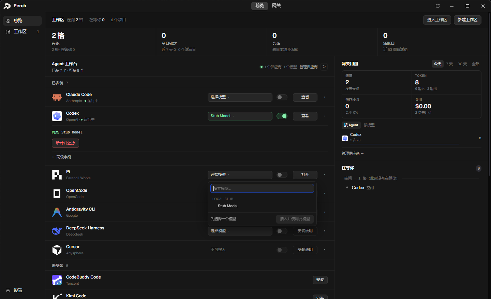

<div align="center">


# Perch

**A desktop workspace for agent terminals.**<br>
Run several agents side by side in one window — one real terminal per pane. Collapse the terminals and it becomes a work board that shows who is waiting on you.


</div>

<p align="center">
  <a href="docs/images/overview.png"></a>
</p>

Perch is a Windows desktop gateway for agent terminals, in the same **agent development environment** category as Orca.
The terminal is the main interface: every pane is a live ConPTY, and the agent runs inside it normally. The layer around it exists to **keep many such panes visible and manageable, and to make it obvious when one stops and waits for you**.
It is not "run N copies of one vendor's agent": the agent is your choice. This layer owns the terminal and the workspace.

## Why Perch

Every agent has its own sessions, its own state, and its own idea of "waiting for you". Open three terminals and you spend the day switching between them. Perch brings them into one window:

- **One real terminal per pane** — parallel grid, independent tabs, status dots; scrollback stays local and is still there when you switch back.
- **Attention first** — whoever is waiting for you comes first. Answer selection prompts from the "Needs you" panel; permission prompts can be allowed or denied from the work board after the terminals are collapsed.
- **Collapse terminals into a work board** — one fixed-height row per agent; the row does not render the transcript; click a row to enter that pane.
- **A gateway that stays out of the way** — providers, agent wiring, and usage live in Perch's own gateway page. A headless local engine does the routing; there is no second app to open and no embedded vendor UI.

## Features

<table>
<tr>
<td width="50%" valign="middle">

### Parallel agent grid

Each pane is a live ConPTY with its own scrollback, tab, and status dot. Switching tabs does not lose output, and the grid keeps the whole team visible at a glance.

</td>
<td width="50%">
  <a href="docs/images/overview.png"></a>
</td>
</tr>
<tr>
<td width="50%" valign="middle">

### Agent wiring and model selection

The model is your choice, never a default Perch picks. Choose one on the agent's row in Overview, from the inline detail, or from the model chip in a running pane (`Ctrl+Shift+M`). Selecting a model writes that exact value through the built-in gateway engine; on an unwired agent the same call connects first and then applies it. Long lists become a searchable popover with no preselection, and the current value is brought into view only when the agent is already wired. An idle pane offers to reopen and resume after a model change; a busy pane saves the choice and waits. Configuration is read back from the engine's `/api/state`, and writes go through the same API — the page never assumes an HTTP 2xx means the agent changed.

</td>
<td width="50%">
  <a href="docs/images/agent-wiring.png"></a>
</td>
</tr>
<tr>
<td width="50%" valign="middle">

### Built-in gateway engine

Perch ships with a headless local gateway engine and a native provider console. The catalog lists every supported provider as a template; pick one, paste a key, and the sheet stays open for model chips and a live key test. Added providers sit above the catalog in one row each. Usage lives in the Overview's right rail (today / 7 / 30 / all), next to the agents it serves. The engine runs as a private child process with its own data directory and a stable loopback address; its web UI is never loaded or proxied. Provider keys go one way — into the engine — and the page only ever sees a masked status.

</td>
<td width="50%">
  <a href="docs/images/gateway.png"></a>
</td>
</tr>
</table>

**Also in the box:**

- **Attention-first work board** — the "Needs you" panel puts the pane that is waiting in front. Selection prompts can be answered there; permission requests can be handled from the work board after the terminal is collapsed.
- **Exact resume, honest fallbacks** — a pane restores the exact session while its file is still on disk. If the session is gone, the seat is kept and a new conversation starts with a banner that explains why.
- **Real terminals, three-legged state** — ConPTY plus xterm.js with local scrollback. State is read from transcripts, agent hooks, and the screen; the three corroborate each other, and a weak signal is never allowed to conclude alone.
- **Read-only file rail** — a file tree and preview beside the active agent. Perch reads files and never edits them behind your back.
- **Close is not delete** — closing a pane stops the run but keeps the record. The agent appears as "closed" in the left rail and can be resumed later under the same pane ID.
- **Install recipes built in** — the agent catalog detects what is installed, runs the official installer or npm package on request, and rescans immediately after installation.
- **Gateway lifecycle** — the engine starts and stops with Perch, keeps the same gateway address across restarts so agent configs stay valid, and never touches a desktop gateway you may already run.

## Supported agents

Perch's catalog contains CLI agents only. Desktop and web clients are not installed or launched by Perch; they belong to the gateway layer. The catalog ships with 15 CLI agents, grouped by integration depth.

### Full integration

These five have dedicated adapters: structured status and exact session resume. They are also installable and launchable through the same Agent CLI list.

<table align="center">
<tr>
<td align="center" width="20%"><br><sub>Claude Code</sub></td>
<td align="center" width="20%"><br><sub>Codex</sub></td>
<td align="center" width="20%"><br><sub>Pi</sub></td>
<td align="center" width="20%"><br><sub>OpenCode</sub></td>
<td align="center" width="20%"><br><sub>DeepSeek Harness</sub></td>
</tr>
</table>

DeepSeek Harness is the non-official case: its official package ships no interactive TUI, so Perch installs the community `dsh-TUI` profile and connects status through the official `dsh-hooks-claude-code` bridge — the same terminal-first shape Orca uses. If the bridge is not installed yet, the catalog row offers **Connect status** instead of pretending the pane is fully wired.

### Install and launch

The other nine have a one-click install recipe — the official installer or an npm package — and can be started in a Perch pane. They share the same icon, detection, install, and launch path.

<table align="center">
<tr>
<td align="center" width="20%"><br><sub>Antigravity CLI</sub></td>
<td align="center" width="20%"><br><sub>Cursor</sub></td>
<td align="center" width="20%"><br><sub>CodeBuddy Code</sub></td>
<td align="center" width="20%"><br><sub>Kimi Code</sub></td>
<td align="center" width="20%"><br><sub>Muse Code</sub></td>
</tr>
<tr>
<td align="center" width="20%"><br><sub>Gemini CLI</sub></td>
<td align="center" width="20%"><br><sub>Copilot CLI</sub></td>
<td align="center" width="20%"><br><sub>Qwen Code</sub></td>
<td align="center" width="20%"><br><sub>Crush</sub></td>
</tr>
</table>

<p align="center">
  
  <sub><b>ZCode</b> — detected and listed in the catalog, but not installed or launched by Perch.</sub>
</p>

**Install** means Perch runs the agent's official installer or npm package after you click "Install". **Launch** means Perch can start it in a pane. Desktop clients are outside this list; any client that can point at a custom base URL can use the built-in gateway.

Two of these go further than install/launch:

- **Antigravity CLI** has session resume wired (`--conversation <id>` / `--continue`). Its native terminal title carries no state (it is the executable path), so Perch offers a one-click **Connect status** action that installs lifecycle hooks (`SessionStart` / `PreInvocation` / `Stop`). Until those hooks are installed the row says, honestly, that there is no status source. Waiting-for-approval is not subscribed: `PreToolUse` is a permission gate and an observer must not answer it.
- **Cursor** has `--resume <chatId>` / `--continue` resume wired, but the regular `cursor-agent` CLI has no status source and cannot be routed through the gateway. The inline detail says so, keeps the gateway action visibly unavailable, and points to native use, `cursor-agent login`, or Cursor Private Inference instead of sending a request that returns HTTP 400.

## Where the data comes from

Three legs, from hardest to softest — the order is deliberate:

1. **Transcript** — the session JSONL on disk. What was said and whether a tool call is still pending are structured facts.
2. **Hooks** — the agent's own hook events; state changes arrive fastest here.
3. **Screen** — the terminal buffer. A fallback, and the only source for some facts (for example, which question of a multi-question prompt you are on) — the transcript only lands after the whole prompt is answered.

The three corroborate each other. A single weak leg is not allowed to conclude on its own: "answered No" is not the same as done, and "still spinning" has a synthetic fallback that is explicitly labeled as synthetic.

## Build

Requires Windows 11 (ConPTY) and Go 1.27+. The frontend has no bundler: one `index.html` plus assets, embedded with `go:embed`.

```powershell
go build -o build\perch.exe ./cmd/perch
go build -o build\perch-hook.exe ./cmd/perch-hook   # hook receiver: the name is hard-coded
.\build\perch.exe
```

Two binaries are required: the main app and a separate hook receiver (the agent's hook events are written by it, and the main app reads them). The receiver's file name is hard-coded (`hookExeName` in the hook code) and both executables must sit side by side in the same directory. If one is missing, features disappear silently.

## Status

- **Experimental**; interfaces will change.
- Windows only (ConPTY and Job Objects).
- Status comes from each agent's own structured source where one exists (hooks, an app-server, an extension, or a local HTTP API); terminal-title glyphs are the fallback. Perch does not auto-write an agent's hooks: agents without a structured source still open, sign in, and run normally, just with less busy/idle detail.
- Process names, the state directory, and the hook receiver are all `perch` / `Perch`; there are no machine-specific absolute paths. On another machine Perch uses that machine's own state root (`CLAUDE_CONFIG_DIR`, or `~/.claude` when unset).

## For contributors

Why the frontend uses classic scripts with `defer`, what belongs in each file, icon rules, and why assets require a rebuild — see [docs/FRONTEND.md](docs/FRONTEND.md). Backend layers and dependency direction are in [docs/ARCHITECTURE.md](docs/ARCHITECTURE.md). Interface languages, translation keys, backend message codes, and the CI guard are in [docs/I18N.md](docs/I18N.md).

## Acknowledgements

This project learned from two open-source implementations, mostly at the level of concrete process (terminal pane layout, status-dot glyphs, the one-agent-per-line activity stream, the auto-scroll state machine). The architecture and data plane are our own. [THIRD-PARTY.md](THIRD-PARTY.md) lists each item and its license.

- [Orca](https://github.com/stablyai/orca) (MIT) — UI styling and a set of implementation details
- [Magpie](https://github.com/yetone/magpie) (MIT) — bundled headless gateway engine; Perch owns the UI and talks to it over its local API

And [xterm.js](https://github.com/xtermjs/xterm.js), [Wails](https://github.com/wailsapp/wails), [Cascadia](https://github.com/microsoft/cascadia-code), [JetBrains Mono](https://github.com/JetBrains/JetBrainsMono), and [Geist](https://github.com/vercel/geist-font).

## License

MIT © 2026 yu7dan. Third-party components and reference implementations are covered in [THIRD-PARTY.md](THIRD-PARTY.md).
